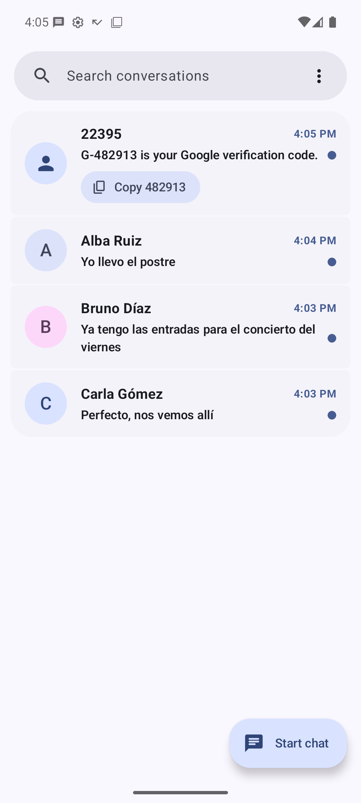
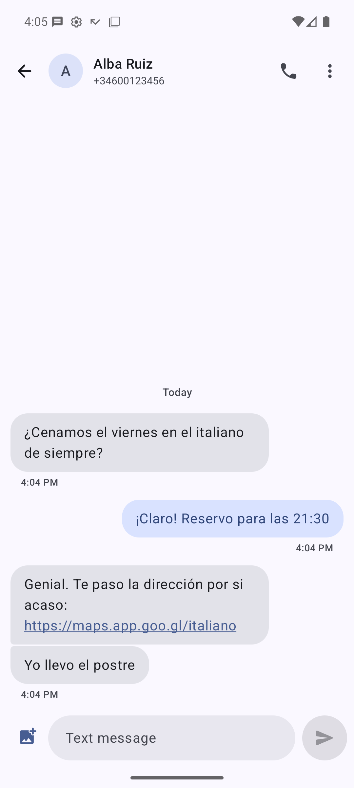
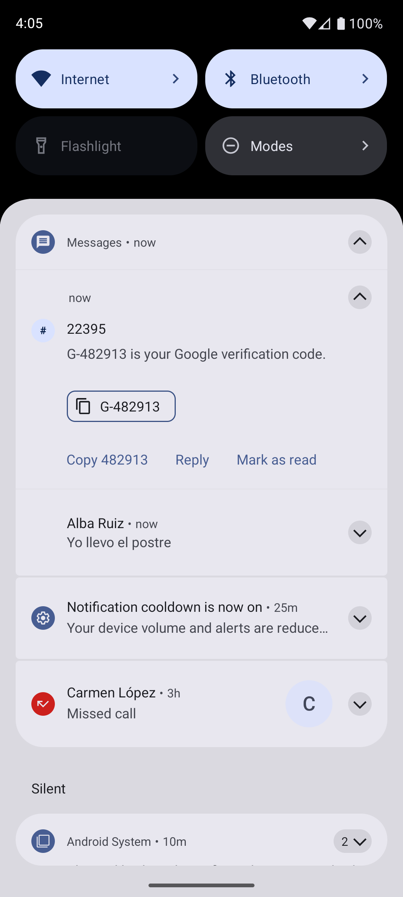
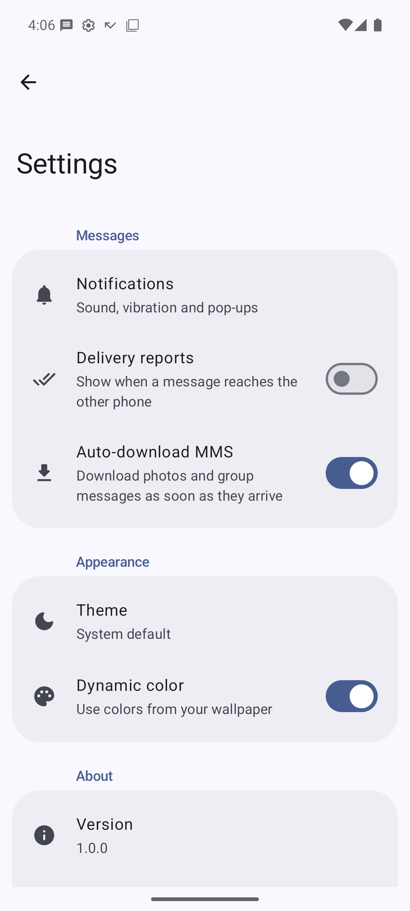

# Messages

A simple SMS and MMS app for Android, built with Kotlin and Jetpack Compose (Material 3 / Material You).

It is a full default SMS app: it receives, sends and stores text and multimedia messages, including group conversations and photos. It has **no internet permission**: your messages never leave the device except through your carrier.

<p align="center">
  
  
  
  
</p>

## Features

### Verification codes
Most SMS today are one-time codes. Messages finds the code in the message ("G-482913 is your Google verification code", "Clave para operar: 4821"…) and lets you copy it with one tap:

- from the notification, with a **Copy 482913** button, without opening the app;
- from the conversation list, while the code is fresh (15 minutes);
- from the message itself.

The code is copied as sensitive, so Android hides it in clipboard previews. Detection only looks at messages that talk about a code, in English and Spanish, and ignores amounts, times, dates, years, phone numbers and order numbers.

### Messaging
- Default SMS app (`ROLE_SMS`): SMS and MMS, sent and received.
- Group conversations and photos (MMS), with automatic or manual download and images compressed to fit the carrier's size limit.
- Long messages split automatically, with a character counter.
- Delivery reports (optional), sending status and tap to retry for failed messages.
- Dual SIM: choose the SIM per conversation.
- Links, emails and phone numbers are tappable.
- Copy, delete and share messages and attachments.

### Notifications
- One notification per conversation with contact avatars.
- Reply and mark as read from the notification.
- Quick replies when declining a call from the phone app.
- No notification for the conversation you have open.

### Conversations
- Search, unread markers, multi-select to mark read/unread or delete.
- New conversation from contacts or any number; long-press to pick several people for a group.
- Opens from other apps (`sms:`, `smsto:`, `mms:` links) and receives shared text and photos.

### Settings
- Theme: system, light or dark, plus wallpaper (dynamic) colors on Android 12+.
- English and Spanish, with per-app language selection on Android 13+.

## Install

Download the APK from the [latest release](https://github.com/hostyn/messages/releases/latest) and open it on your phone (Android 8.0 or later). Then open the app and accept the prompt to make it the default SMS app. Your existing messages stay where they are: Android stores them, not the app.

Releases are signed with this certificate. You can check it with [AppVerifier](https://github.com/soupslurpr/AppVerifier) or `apksigner verify --print-certs`:

```
dev.hostyn.messages
EC:D6:BD:FC:52:58:65:A9:B5:C3:00:A7:60:5F:9F:E3:B6:B7:70:F2:84:50:16:C6:63:8D:06:B8:F0:C5:64:36
```

## Building

Requirements: JDK 17 and the Android SDK.

```bash
./gradlew installDebug         # build and install a debug build on a connected device
./gradlew testDebugUnitTest    # unit tests (MMS encoding, code detection)
./gradlew assembleRelease      # unsigned release build, minified with R8
```

To make a signed release, run `scripts/release.sh`. It builds the release, signs it with the key in `~/keystores/phone-release.p12` (or the path you pass as the first argument), asking for the password, and writes `dist/messages-<version>.apk`.

## Tech stack

- Kotlin, Jetpack Compose, Material 3, Navigation Compose
- Android Telephony (`SmsManager`, `Telephony` provider, `RoleManager`)
- Its own MMS PDU encoder and decoder (WAP-209/WSP), since Android doesn't expose one to apps
- [Coil](https://coil-kt.github.io/coil/) for photos and contact pictures

## Project structure

```
app/src/main/java/dev/hostyn/messages/
├── data/        Conversations and messages (Telephony provider), contacts, settings
├── sms/         Sending, receiving and delivery reports
├── mms/         MMS PDU codec, sending, downloading and storage
├── otp/         Verification code detection and copying
├── notify/      Notifications and their actions
└── ui/          Compose screens: conversations, conversation, new chat, settings
```

## License

Copyright (C) 2026 Rubén Martínez Hostyn

This program is free software: you can redistribute it and/or modify it under the terms of the GNU General Public License as published by the Free Software Foundation, either version 3 of the License, or (at your option) any later version. See [LICENSE](LICENSE) for the full text.
